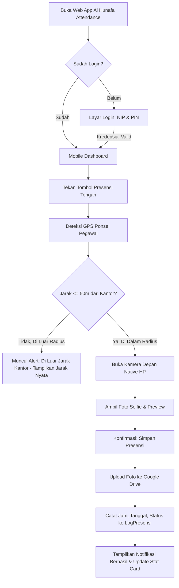

# PRODUCT REQUIREMENT DOCUMENT (PRD)
# Sistem Presensi Pegawai: "Al Hunafa Attendance"

Dokumen Spesifikasi Produk & Master Arsitektur Rekayasa Sistem (by ZettBOT).

================================================================================
ZONA 1: SPESIFIKASI KEBUTUHAN PRODUK (BLUEPRINT AWAL)
================================================================================

## 1. Identitas Projek & Problem Statement
- **Nama Aplikasi**: Al Hunafa Attendance
- **Platform**: Web App Responsif Mobile-First berbasis Google Apps Script (GAS) + Google Sheets + Google Drive.
- **Problem Statement**:
  Institusi Al Hunafa memerlukan sistem presensi kehadiran pegawai yang akurat, anti-titip absen, bebas biaya langganan bulanan server, dan mudah digunakan langsung dari ponsel pegawai. Sistem memvalidasi radius jarak pegawai (maksimal 50 meter dari kantor) menggunakan rumus Geofencing Haversine serta mewajibkan foto selfie masuk & pulang yang tersimpan rapi langsung di Google Drive institusi.

---

## 2. Peran Pengguna (User Roles)
1. **User (Pegawai)**:
   - Masuk (Login) menggunakan NIP/ID Pegawai + PIN 6-digit.
   - Tampilan antarmuka mobile mewah bernuansa *Deep Sage Green* persis referensi visual (Dynamic Island, StatusBar, Greeting, Location Pill, 4 Stat Cards, Riwayat Presensi).
   - Tombol Floating Action Scan Presensi melayang di tengah navigasi bawah.
   - Melakukan Check-In dan Check-Out dengan verifikasi GPS (<= 50 meter) dan upload foto selfie instan via kamera native ponsel.
   - Memantau ringkasan bulanan: Status Check In, Check Out, Total Hari Hadir, Total Terlambat/Absen.
   - Mengajukan Izin/Sakit/Cuti pada tab "Leave".
2. **Admin**:
   - Memiliki kredensial Admin khusus (atau NIP ber-role Admin).
   - Dashboard Admin untuk:
     * Pengaturan Titik GPS Kantor (Latitude, Longitude) dengan tombol praktis "Deteksi Lokasi Saya" atau input koordinat manual.
     * Pengaturan Toleransi Radius (Default 50 Meter).
     * Pengaturan Jam Masuk (08:00) & Jam Pulang (17:00).
     * Manajemen Data Pegawai (Tambah, Edit, Nonaktifkan, Reset PIN).
     * Monitoring & Rekap Log Absensi seluruh pegawai secara realtime.
     * Persetujuan Pengajuan Izin / Sakit / Cuti.
     * Tombol "Export ke Excel / Google Sheets" untuk laporan payroll harian/bulanan.

---

## 3. Arsitektur & Lingkungan Kerja
- **Engine Backend**: Google Apps Script (`code.gs`) yang menangani API JSON, integrasi Google Drive API, dan kalkulasi jarak Haversine.
- **Database**: Google Sheets Spreadsheet (`setup.gs` untuk *Safe Migration* idempoten tanpa underscore pada nama sheet).
- **Penyimpanan Foto**: Google Drive Folder (dikelola otomatis oleh backend GAS, file terstruktur per bulan/tahun dengan format penamaan rapi).
- **Frontend**: Single-Page Application (SPA) Mobile-First (`index.html`) menggunakan Vanilla CSS modern (Anti-AI Human-Crafted aesthetic) dan JavaScript native tanpa library berat.
- **Mode Eksekusi Kamera**: `<input type="file" capture="user" accept="image/*">` native mobile camera (kebal blokir sandbox iframe GAS di iOS Safari & Android Chrome).

---

## 4. Alur Kerja Aplikasi (User Flow)

---

## 5. Desain Basis Data (Google Sheets Tabs)
> **PENTING**: Mengikuti SOP ZettBOT, nama tab tidak menggunakan underscore (`_`), dan pembacaan data di backend menggunakan *Index-Based Mapping* (urutan kolom tetap).

### Tab 1: `DataKaryawan`
| Indeks | Nama Header | Tipe Data | Contoh Data | Keterangan |
| :--- | :--- | :--- | :--- | :--- |
| COL 0 | ID_KARYAWAN | String | `PEG-001` | ID Unik Terurut |
| COL 1 | NIP | String | `1001` | Nomor Induk Pegawai |
| COL 2 | NAMA_LENGKAP | String | `Akhmad Maariz` | Nama Karyawan |
| COL 3 | ROLE | String | `Pegawai` | `Admin` / `Pegawai` |
| COL 4 | JABATAN | String | `Staff Operasional` | Jabatan/Divisi |
| COL 5 | PIN | String | `123456` | Kredensial Masuk |
| COL 6 | STATUS_AKTIF | String | `Aktif` | `Aktif` / `Nonaktif` |

### Tab 2: `LogPresensi`
| Indeks | Nama Header | Tipe Data | Contoh Data | Keterangan |
| :--- | :--- | :--- | :--- | :--- |
| COL 0 | ID_PRESENSI | String | `ATT-202610-001` | ID Unik Presensi |
| COL 1 | ID_KARYAWAN | String | `PEG-001` | Relasi ke DataKaryawan |
| COL 2 | NAMA_KARYAWAN | String | `Akhmad Maariz` | Snapshot Nama |
| COL 3 | TANGGAL | String | `2026-10-23` | Format YYYY-MM-DD |
| COL 4 | WAKTU_MASUK | String | `07:58:12` | Jam Check-In |
| COL 5 | STATUS_MASUK | String | `Tepat Waktu` | `Tepat Waktu` / `Terlambat` |
| COL 6 | JARAK_MASUK_METER | Number | `18.5` | Jarak saat absen masuk |
| COL 7 | FOTO_MASUK_URL | String | `https://drive.google.com/...` | Link Foto Masuk Drive |
| COL 8 | WAKTU_PULANG | String | `17:05:40` | Jam Check-Out |
| COL 9 | STATUS_PULANG | String | `Tepat Waktu` | `Tepat Waktu` / `Pulang Cepat` |
| COL 10 | JARAK_PULANG_METER | Number | `22.1` | Jarak saat absen pulang |
| COL 11 | FOTO_PULANG_URL | String | `https://drive.google.com/...` | Link Foto Pulang Drive |
| COL 12 | TOTAL_JAM_KERJA | String | `09:07` | Selisih Jam |
| COL 13 | LOKASI_CATATAN | String | `Office, Jakarta Barat` | Nama titik lokasi |

### Tab 3: `PengaturanSistem`
| Indeks | Nama Header | Tipe Data | Contoh Nilai |
| :--- | :--- | :--- | :--- |
| COL 0 | KUNCI_PENGATURAN | String | `LATITUDE_KANTOR` |
| COL 1 | NILAI_PENGATURAN | String | `-6.175392` |
| COL 2 | KETERANGAN | String | `Titik Garis Lintang Kantor` |

*Kunci pengaturan default:*
- `NAMA_KANTOR`: "Al Hunafa Attendance Center"
- `LATITUDE_KANTOR`: "-6.175392"
- `LONGITUDE_KANTOR`: "106.827153"
- `RADIUS_MAKSIMAL_METER`: "50"
- `JAM_MASUK_STANDAR`: "08:00"
- `JAM_PULANG_STANDAR`: "17:00"
- `GOOGLE_DRIVE_FOLDER_ID`: "(Auto-provisioned / Set oleh Script)"

### Tab 4: `PengajuanIzin`
| Indeks | Nama Header | Tipe Data | Contoh Data | Keterangan |
| :--- | :--- | :--- | :--- | :--- |
| COL 0 | ID_PENGAJUAN | String | `LEV-202610-001` | ID Unik |
| COL 1 | ID_KARYAWAN | String | `PEG-001` | ID Karyawan |
| COL 2 | NAMA_KARYAWAN | String | `Akhmad Maariz` | Nama Karyawan |
| COL 3 | JENIS_PENGAJUAN | String | `Sakit` | `Sakit` / `Izin` / `Cuti` |
| COL 4 | TANGGAL_MULAI | String | `2026-10-24` | Tanggal Mulai |
| COL 5 | TANGGAL_SELESAI | String | `2026-10-25` | Tanggal Akhir |
| COL 6 | ALASAN | String | `Demam tinggi` | Keterangan |
| COL 7 | BUKTI_URL | String | `https://drive.google.com/...` | Foto Surat Dokter |
| COL 8 | STATUS_APPROVAL | String | `Menunggu` | `Menunggu` / `Disetujui` / `Ditolak` |

---

## 6. Aturan Validasi & Logika Khusus

### A. Formula Geofencing Haversine (Akurasi Tinggi Jarak Bumi)
Kalkulasi jarak $d$ (meter) antara posisi pegawai $(lat_1, lon_1)$ dan titik kantor $(lat_2, lon_2)$:
$$R = 6371000 \text{ meter}$$
$$\Delta lat = (lat_2 - lat_1) \times \frac{\pi}{180}, \quad \Delta lon = (lon_2 - lon_1) \times \frac{\pi}{180}$$
$$a = \sin^2\left(\frac{\Delta lat}{2}\right) + \cos(lat_1 \times \frac{\pi}{180}) \times \cos(lat_2 \times \frac{\pi}{180}) \times \sin^2\left(\frac{\Delta lon}{2}\right)$$
$$c = 2 \times \text{atan2}\left(\sqrt{a}, \sqrt{1-a}\right)$$
$$d = R \times c$$
- **Syarat Validasi**: $d \le \text{RADIUS\_MAKSIMAL\_METER}$ (Default 50m).
- Jika $d > 50\text{m}$, tombol simpan terkunci dengan peringatan: *"Anda berada sejauh X meter dari kantor (Batas maksimal 50m)"*.

### B. Otomatisasi Status Kehadiran
- **Jam Masuk**: Jika waktu absen $\le$ `JAM_MASUK_STANDAR` (contoh 08:00) $\rightarrow$ *"Tepat Waktu"*. Jika lewat $\rightarrow$ *"Terlambat"*.
- **Jam Pulang**: **Fleksibel**. Sistem tidak membatasi atau menghakimi jam pulang (karena jadwal pegawai bervariasi, ada yang pulang jam 14:00, jam 15:00, dll.). Sistem murni fokus menghitung durasi jam kerja riil dari waktu Check-In hingga waktu Check-Out.

### C. Penomoran Unik Incremental Anti-Tabrakan
- Log Presensi: `ATT-YYYYMM-XXX` (misal `ATT-202610-001`, `ATT-202610-002`) menggunakan pemindaian nomor urut maksimal + penguncian `LockService`.
- Pengajuan Izin: `LEV-YYYYMM-XXX`.

### D. Kompresi Foto Sebelum Kirim ke Google Drive
- Foto selfie di sisi browser dikompresi otomatis (Maksimal lebar 1080px, kualitas JPEG 0.8) sebelum dikirim via base64 ke Google Apps Script agar proses upload cepat (< 2 detik) dan menghemat kuota Google Drive.

### E. Kalkulasi Otomatis Total Jam Kerja Riil (Check-In s/d Check-Out)
- Saat pegawai melakukan **Check-Out**, sistem otomatis menghitung durasi jam kerja dari selisih waktu Check-In hingga Check-Out:
  $$\Delta t = \text{Waktu Check-Out} - \text{Waktu Check-In}$$
  $$\text{Total Jam} = \lfloor \Delta t / 3600000 \rfloor, \quad \text{Total Menit} = \lfloor (\Delta t \pmod{3600000}) / 60000 \rfloor$$
- **Format Tampilan**: `HH:mm` (contoh: `08:03`) serta teks ramah `"8 Jam 3 Menit"`.
- **Penempatan di Antarmuka**:
  1. **Kartu Riwayat Presensi**: Ditampilkan di kolom `Total Hours` (contoh: `08:03` persis seperti di screenshot).
  2. **Notifikasi Sukses Check-Out**: Muncul ucapan terima kasih disertai ringkasan durasi kerja hari ini.
  3. **Laporan & Rekap Admin**: Terakumulasi otomatis untuk memudahkan perhitungan payroll / lembur.

---

## 7. Rencana Antarmuka & Desain Visual (Persis Screenshot)
1. **Mockup Frame Smartphone (Dynamic Island & Native Bar)**:
   - Header atas: Jam `9:41`, ikon sinyal, wifi, baterai, Dynamic Island oval hitam elegan.
   - Sapaan hangat: `Good Morning, Akhmad Maariz` dengan ikon lonceng notifikasi.
   - Baris status tanggal: `Thursday, 23 November 2023` + Location pill badge hijau sage `West Jakarta, Indonesia`.
2. **2 Kartu Metrik Utama (Grid 2 Kolom)**:
   - Kartu 1: `Check In` (Jam 07:58, Badge "Early" / "On Time", ikon panah miring bawah bulat hijau).
   - Kartu 2: `Check Out` (Jam 17:00 / "Not Yet", ikon panah miring atas).
   - *Catatan Revisi*: Kartu Absence & Total Attended dihilangkan dari dashboard utama agar antarmuka lebih lapang, fokus, dan minimalis.
3. **Bagian Attendance History**:
   - Header "Attendance History" dengan tombol "See More".
   - Kartu riwayat elegan: Kotak tanggal hijau sage bersudut halus (misal `22 Wed`), kolom jam Check In, Check Out, Total Hours, dan alamat titik kantor.
4. **Bottom Navigation Bar dengan Tombol Presensi Mengambang**:
   - Tab 1: **Home** (Aktif)
   - Tab 2: **Analytics** (Grafik & ringkasan bulanan)
   - Tombol Tengah: **Floating Scan Camera Button** (Lingkaran besar hijau sage dengan ikon scan wajah/presensi untuk memicu foto & absensi)
   - Tab 3: **Leave** (Formulir & riwayat pengajuan izin/sakit/cuti)
   - Tab 4: **Settings / Admin** (Pengaturan titik koordinat GPS kantor, master pegawai, rekap)
5. **Modal Scan Presensi Pop-up**:
   - Status radius GPS live: Indikator hijau (di dalam radius 50m) atau merah (di luar kantor) dengan jarak real-time.
   - Tombol Ambil Selfie Kamera Depan.
   - Preview foto jepretan sebelum konfirmasi.
   - Pilihan: Check-In Masuk atau Check-Out Pulang.

---

## 8. Kriteria Pengujian (Checklist QA)
- [ ] Pegawai dapat login dengan NIP & PIN yang terdaftar di sheet `DataKaryawan`.
- [ ] Admin dapat login dan membuka tab Settings khusus pengaturan kantor.
- [ ] Deteksi GPS mengukur jarak akurat dan menolak absensi jika $> 50$ meter dari kantor.
- [ ] Pengambilan foto selfie membuka kamera native ponsel dan ter-upload ke Google Drive.
- [ ] Data tersimpan rapi di sheet `LogPresensi` dengan link foto Drive yang bisa dibuka.
- [ ] Total jam kerja (Check-In s/d Check-Out) terhitung otomatis dalam format 'HH:mm' dan tampil di kartu riwayat presensi.
- [ ] Dashboard menampilkan kartu status Check In, Check Out, dan riwayat presensi yang sinkron.
- [ ] Pegawai dapat mengajukan izin/sakit pada tab "Leave".
- [ ] Admin dapat mengubah koordinat kantor dan radius langsung dari menu Settings.

================================================================================
ZONA 2: MASTER CONTEXT & LOGIKA SISTEM TERKINI (LIVING CONTEXT)
================================================================================
- **Status Arsitektur**: Single-Folder Google Apps Script Ecosystem.
  * `code.gs`: Backend API, Routing, Google Drive Folder Uploader, Haversine Engine.
  * `setup.gs`: Inisialisasi Database Google Sheets (`DataKaryawan`, `LogPresensi`, `PengaturanSistem`, `PengajuanIzin`) + Dummy Data.
  * `index.html`: Mobile UI lengkap dengan CSS Human-Crafted, Bottom Nav, Floating Camera Trigger, GPS Geolocation & Offline-tolerant state.
- **Konstanta Pemetaan Kolom Aktif (Index-Based)**:
  * `COL_KARYAWAN = { ID: 0, NIP: 1, NAMA: 2, ROLE: 3, JABATAN: 4, PIN: 5, AKTIF: 6, FOTO: 7, EMAIL: 8, USERNAME: 9 }`
  * `COL_PRESENSI = { ID: 0, ID_PEG: 1, NAMA: 2, TGL: 3, IN_TIME: 4, IN_STAT: 5, IN_DIST: 6, IN_FOTO: 7, OUT_TIME: 8, OUT_STAT: 9, OUT_DIST: 10, OUT_FOTO: 11, HOURS: 12, LOKASI: 13 }`
  * `COL_CONFIG = { KEY: 0, VAL: 1, DESC: 2 }`
  * `COL_IZIN = { ID: 0, ID_PEG: 1, NAMA: 2, JENIS: 3, START: 4, END: 5, ALASAN: 6, BUKTI: 7, STATUS: 8 }`
- **Penyelarasan Sistem Terkini (v2.4.0 - 28 Oktober 2026)**:
  * **Penghapusan Total Fitur Pengajuan Lembur**:
    - Tombol sub-tab switcher pada menu *Leave* dihapus; menu Leave murni khusus untuk pengajuan Izin, Sakit, dan Cuti.
    - Formulir pengajuan lembur, kalkulator jam lembur, riwayat lembur pegawai, dan panel approval lembur di Admin dibersihkan.
    - Backend dan database kembali ringan dan fokus pada presensi dan perizinan.
  * **Transisi ke Tampilan Web Normal & Responsif (Non-iPhone Frame)**:
    - Mockup casing fisik iPhone (border hitam 22px, corner radius 44px, dan bayangan tebal) dihapus.
    - Dynamic Island (poni notch kamera) dan Status Bar iOS (jam `20:32`, sinyal, wifi, baterai) dihilangkan total.
    - Antarmuka beroperasi sebagai aplikasi web modern profesional (container bersih maksimal 640px di PC/laptop dan adaptif penuh/fluid di ponsel).
  * **Universal Camera Dual-Fallback Engine (Laptop & Ponsel)**:
    - Mengatasi kegagalan kamera di laptop/PC: Sistem mencoba `facingMode: "user"` terlebih dahulu, dan jika ditolak langsung beralih ke stream kamera umum `{ video: true }` tanpa crash.
    - Didukung fallback kamera native HP (`capture="user"`) serta tombol pemilihan berkas galeri sebagai cadangan darurat.
  * **Jam Kerja Fleksibel Bebas Sistem (Berpatokan pada Total Jam Kerja Riil)**:
    - Tidak ada batasan kaku jam masuk (08:00) dan jam pulang (17:00).
    - Menghilangkan vonis status "Terlambat" atau "Pulang Cepat"; seluruh kehadiran dicatat dengan status `"Hadir"`.
    - Patokan evaluasi kehadiran difokuskan 100% pada **Total Jam Kerja Riil** ($\Delta t = \text{Check Out} - \text{Check In}$) yang terakumulasi otomatis di dashboard, riwayat absensi, serta rekap laporan Excel (.xlsx) dan PDF.
- **Versi Rilis Aktif**: v2.6.0 (Daily Attendance Cycle Auto-Reset & Timezone-Resilient Employee Matching).
- **Penyelarasan Sistem Terkini (v2.6.0 - 28 Oktober 2026)**:
  * **Perbaikan Data Presensi Hari Ini (Cecep Rahmat & Seluruh Pegawai)**:
    - Pembacaan tanggal dan jam pada `normalizeDateToYMD_()` dan `formatTimeOnly()` menggunakan `Utilities.formatDate(..., "Asia/Jakarta", ...)` sehingga bebas dari pergeseran tanggal akibat perbedaan timezone server Google Apps Script.
    - Menambahkan pencocokan multi-kunci (*multi-key matcher*): mencocokkan `ID Karyawan`, `NIP`, atau `Nama Lengkap` agar data presensi Cecep yang tersimpan di Google Sheets langsung terdeteksi dan tampil di dashboard.
    - Fallback otomatis ID Karyawan pada `apiLogin` jika kolom ID Karyawan di sheet dibiarkan kosong, otomatis memakai NIP.
  * **Siklus Presensi Harian (Auto-Reset di Hari Baru)**:
    - Data Check In dan Check Out di dashboard hanya berlaku untuk tanggal hari ini (WIB).
    - Jika berganti hari (memasuki tanggal baru), `AppState.todayRecord` secara otomatis di-reset ke `null`.
    - Kartu Check In dan Check Out otomatis ter-reset kembali ke `--:--` ("Belum Presensi"), siap untuk presensi hari berikutnya. Riwayat hari-hari sebelumnya tersimpan di *Attendance History*.
- **Penyelarasan Sistem Terkini (v2.11.0 - 29 Oktober 2026)**:
  * **Kop Laporan Cetak Resmi Al Hunafa**:
    - Memasang logo resmi Al Hunafa di bagian atas kop rekapitulasi presensi cetak PDF (`#printReportArea`) lengkap dengan gambar resolusi tajam dan fallback otomatis thumbnail Google Drive.
  * **Penghapusan Kolom Status Masuk & Status Pulang pada Rekap Laporan**:
    - Kolom "Status Masuk" dan "Status Pulang" dihapus dari lembar cetak PDF (kini 7 kolom ringkas: No, ID Presensi, Nama Pegawai, Tanggal, Check In, Check Out, Total Jam).
    - Ekspor berkas Excel (.xlsx) diselaraskan tanpa kolom status masuk/pulang, berfokus murni pada akumulasi Total Jam Kerja riil pegawai.
  * **Navigasi Beranda Prioritas Pasca Login**:
    - Setiap proses otentikasi login berhasil, aplikasi selalu mengarahkan pengguna secara tegas ke halaman Beranda (`Home`) dan mereset memori sesi tab aktif ke Beranda (tidak lagi terpental ke halaman Pengaturan).
- **Penyelarasan Sistem Terkini (v2.12.0 - 29 Oktober 2026)**:
  * **Tipografi Nama Proporsional & Anti-Ellipsis**:
    - Menghapus pemotongan paksa `ellipsis` pada header nama; menggunakan `clamp()` responsif dan word-break sehingga nama panjang tampil utuh dan proporsional di layar HP.
  * **Pembersihan Fitur Absensi Pribadi Role Admin**:
    - Menyembunyikan kartu Check In/Out, banner status presensi, dan tombol kamera melayang pada akun Admin.
    - Halaman Beranda Admin murni berfungsi sebagai Dashboard Pemantauan Presensi Pegawai Hari Ini (LIVE).
- **Penyelarasan Sistem Terkini (v2.13.0 - 29 Oktober 2026)**:
  * **Pemisahan Tampilan Modul Izin (Admin: Approval, Pegawai: Form & Riwayat)**:
    - Tab Izin pada akun Admin murni berfungsi sebagai Pusat Persetujuan Izin (`Approval Center`) dengan aksi Setujui / Tolak dan peninjau bukti lampiran.
    - Tab Izin pada akun Pegawai menyajikan formulir pengajuan izin lengkap dengan fitur upload foto bukti surat sakit / dokumen pendukung ke Google Drive.
- **Penyelarasan Sistem Terkini (v2.14.0 - 29 Oktober 2026)**:
  * **Arsitektur Modular Google Apps Script (Pemecahan Berkas `index.html`)**:
    - Memecah berkas tunggal monolitik `index.html` (5.118 baris) menjadi 3 modul bersih & modular:
      1. [css.html](file:///c:/Users/dimas/.gemini/antigravity-ide/project/absensi_pegawai/css.html) (1.747 baris): Tema Deep Sage Green, token visual, tata letak responsif, dan animasi antarmuka.
      2. [js.html](file:///c:/Users/dimas/.gemini/antigravity-ide/project/absensi_pegawai/js.html) (2.531 baris): Kontroler state, GPS Haversine, modul kamera & galeri, Chart.js, SheetJS, dan API handler.
      3. [index.html](file:///c:/Users/dimas/.gemini/antigravity-ide/project/absensi_pegawai/index.html) (839 baris): Struktur semantik murni HTML5 dengan scriptlet `<?!= include('css'); ?>` dan `<?!= include('js'); ?>`.
    - Menambahkan helper `include(filename)` pada [code.gs](file:///c:/Users/dimas/.gemini/antigravity-ide/project/absensi_pegawai/code.gs) untuk evaluasi template GAS otomatis.
- **Penyelarasan Sistem Terkini (v2.15.0 - 29 Oktober 2026)**:
  * **Arsitektur Jamstack Hybrid (Vercel Frontend + Google Sheets/Drive Database)**:
    - Frontend statis dideploy pada platform Vercel (`index.html`, `style.css`, `app.js`, `vercel.json`) untuk performa tinggi, SSL gratis, dan domain kustom.
    - Database operasional tetap 100% menggunakan Google Sheets institusi (`DataKaryawan`, `LogPresensi`, `PengajuanIzin`, `PengaturanSistem`) serta penyimpanan foto selfie & surat izin di Google Drive.
    - Mengintegrasikan Universal API Bridge (`createUniversalGasRunner`) dalam `app.js` yang menghubungkan seluruh fungsi presensi client ke Google Apps Script Web App Endpoint via `fetch(POST)` tanpa CORS error.
    - Menambahkan input dinamis `#adminGasApiUrlInput` pada menu Pengaturan Admin agar tautan Web App Apps Script dapat dikonfigurasi kapan saja tanpa perlu deploy ulang frontend.
- **Penyelarasan Sistem Terkini (v2.16.0 - 29 Oktober 2026)**:
  * **Sinkronisasi Lengkap Seluruh Aksi API Backend & Client-Side In-Memory Caching (Anti-Lag)**:
    - Memperluas fungsi `doPost(e)` di [code.gs](file:///c:/Users/dimas/.gemini/antigravity-ide/project/absensi_pegawai/code.gs) dengan penanganan aksi *case-insensitive* untuk seluruh endpoint (`submitIzin`, `getFilteredReport`, `saveConfig`, `getAdminDashboard`, `saveKaryawan`, dll.).
    - Mengimplementasikan *Client-Side In-Memory Caching* (`AppState.cache`) pada [app.js](file:///c:/Users/dimas/.gemini/antigravity-ide/project/absensi_pegawai/app.js) untuk transisi antar-menu instan (0 detik tanpa loading berulang).
    - Menambahkan throttling 4 detik pada event listener aktivitas idle untuk melenyapkan micro-stutter saat scrolling di layar ponsel.
    - Mengompresi foto bukti surat dokter/izin otomatis ke resolusi optimal 960px dan JPEG 0.75 (~70-120KB) sehingga pengiriman pengajuan izin tuntas dalam waktu < 1 detik.
    - Mengaktifkan hardware acceleration CSS dan momentum scrolling `-webkit-overflow-scrolling: touch;` pada viewport antarmuka.
